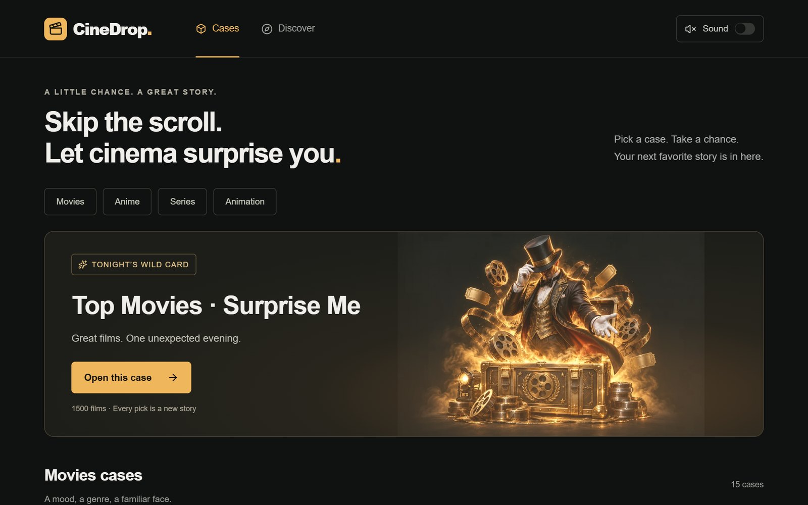
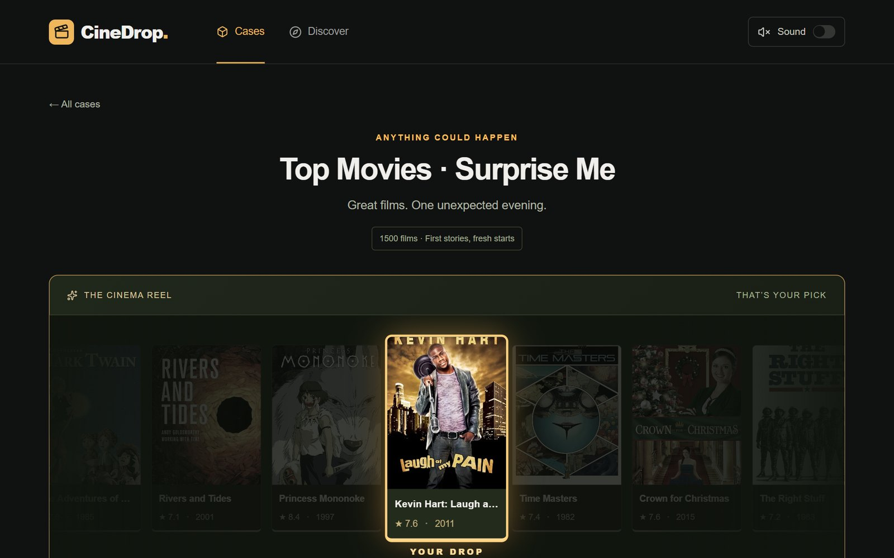
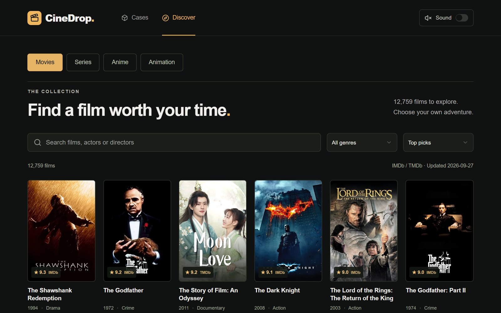
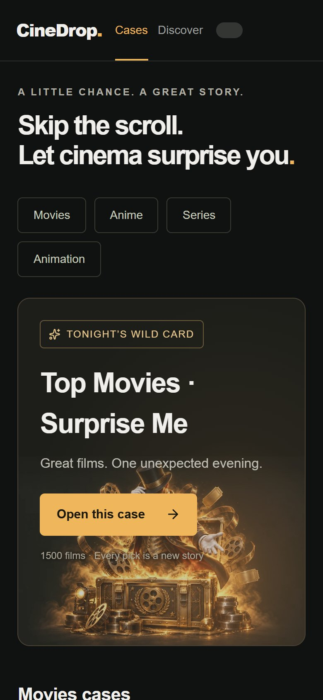

# CineDrop — let cinema surprise you

Can't decide what to watch? Pick a themed case, spin the reel, and CineDrop drops your next film.

**[Open the live site → cinedrop-beta.vercel.app](https://cinedrop-beta.vercel.app)**

## Features

- **Case opening** — choose a case and spin the cinema reel; it stops on one title, your pick for tonight.
- **Themed cases** — 15 movie cases (genres, themes, actor and director ensembles), plus 5 each for anime, series and animation. Each case holds up to 1,500 titles.
- **Discover** — browse a catalog of 12,759 films, search by film, actor or director, filter by genre and sort.
- **Ratings with sources** — every rating shows where it comes from (IMDb or TMDb) and its snapshot date.
- **Sound effects** — optional reel sounds, off by default.
- **Responsive** — works on phones and desktops.

## Screenshots

| The reel lands on your pick | Discover the catalog |
| --- | --- |
|  |  |

## Tech stack

| Area | Technology |
| --- | --- |
| Framework | [Next.js](https://nextjs.org/) (App Router) and React |
| Icons | [Lucide](https://lucide.dev/) |
| Data | Film datasets derived from TMDb, plus Stremio Cinemeta / MetaHub for recent titles and posters |
| Hosting | [Vercel](https://vercel.com/) |

## Data

The catalog combines the TMDb / Udacity dataset, The Movies Dataset and a 250-film demo collection, refreshed with recent releases from Cinemeta. Posters fall back to an alternate source when the main image fails. Ratings are historical snapshots, not live rankings.

This product uses TMDB API-derived datasets but is not endorsed or certified by TMDB. Film imagery and metadata belong to TMDB and the respective rights holders.

## Source code

The source code is private. I'm happy to walk through it — get in touch through my GitHub profile.
